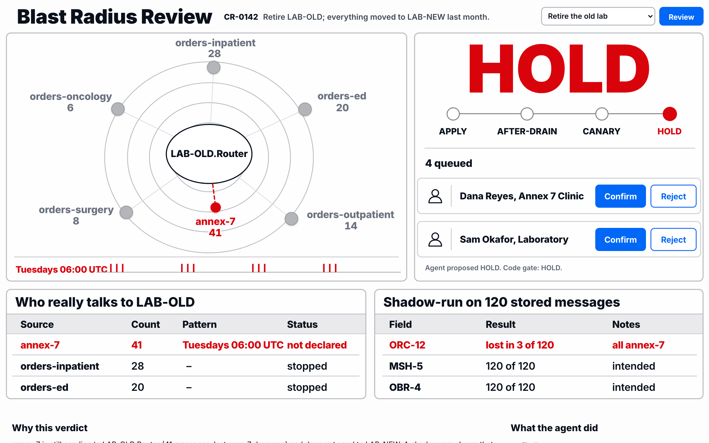
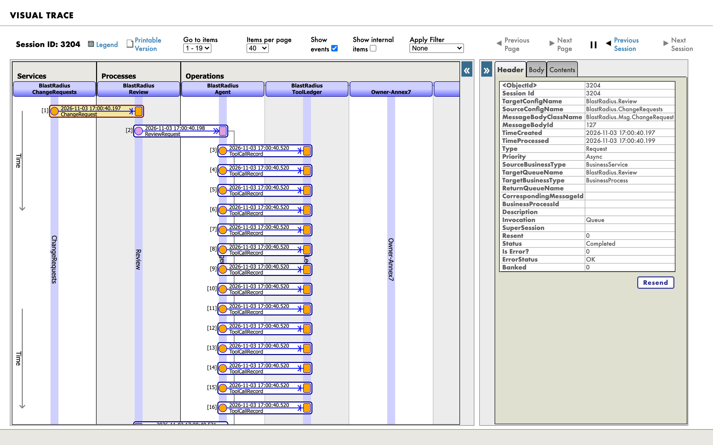
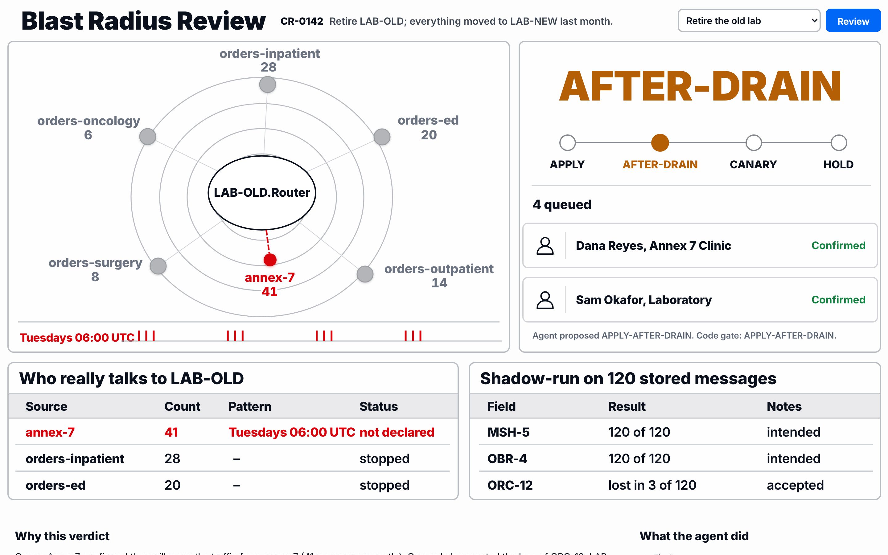
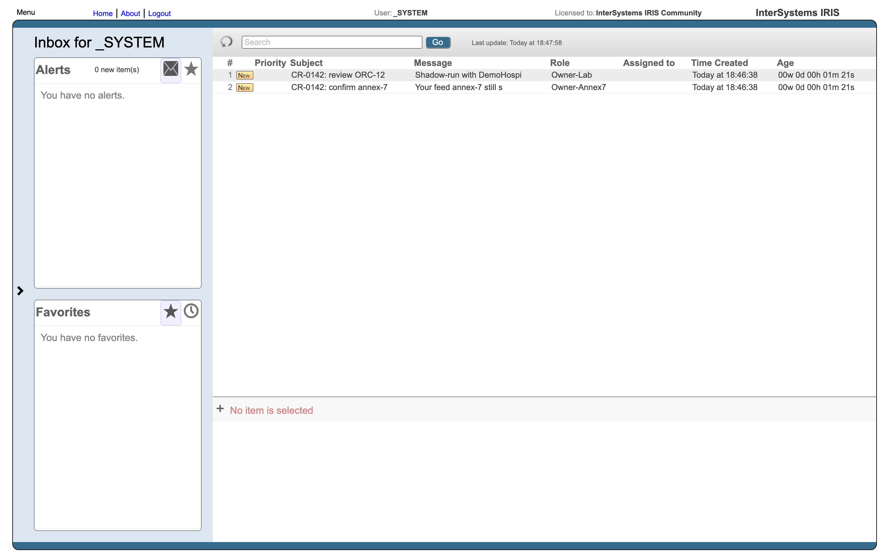

# Blast Radius Review

Before anyone changes a live IRIS integration, an AI Hub agent finds everything that depends on it, tests the change on stored messages, and says whether to go ahead. It never applies anything itself.

Built for the InterSystems programming contest *AI Agents in Interoperability Workflows*. Runs on **AI Hub Community build 2027.1.0AI.109.0, IRIS for Health**.



An engineer writes "Retire LAB-OLD; everything moved to LAB-NEW last month." Everything had moved, except `annex-7`:

```
HOLD
annex-7 sends to LAB-OLD.Router (41 messages in 30 days, Tuesdays 06:00 UTC), and nothing declares that link.
Shadow-run: 3 of 120 stored messages lose field ORC-12, and nothing says that is intended.
```

Its target is read from a Lookup Table at run time, so neither the production diagram nor Interface Maps can show it. The message headers can.

## Why this exists

Every integration team asks the same question before retiring or changing an interface: who still uses this? The honest answer is usually in somebody's head. A real hospital group described in the literature runs [534 interfaces on seven production servers, 86 of them legacy](https://www.scitepress.org/Papers/2021/102420/102420.pdf) (Linecker and Wöß, HEALTHINF 2021). Nobody holds that list in their head.

I know what the wrong answer costs. On a migration night in 2026 a shared address was moved because the list said about 20 of our domains sat behind it. Hundreds of other stores did too, and they were down for about four hours. The list had been made from our own records, and it was wrong because nobody looked at the traffic. This project is that check, as an Interoperability workflow, for the people who run IRIS productions.

## How this answers the contest task

A change request is an Interoperability message. It enters through a Business Service and runs through a BPL process:

```
REST or portal
   │
   ▼
BlastRadius.ChangeRequests   Business Service
   │
   ▼
BlastRadius.Review           BPL process
   ├── BlastRadius.Agent     Business Operation on the stock EnsLib.AI.Agent.OutboundAdapter.
   │     │                   The AI Hub agent reads the production and proposes a verdict.
   │     ├── tools           configuration, 30 days of traffic, queue depth, shadow-run, owners
   │     └── code gate       works out the softest verdict the evidence allows
   ├── Owner-Annex7, Owner-Lab   Workflow tasks, on a HOLD, to the owners on record
   └── BlastRadius.Agent     second review, now with what the owners answered
```

The decision has four outcomes: **APPLY**, **APPLY-AFTER-DRAIN**, **CANARY-FIRST**, **HOLD**. The whole review is one session, so you can follow it in Visual Trace like any other message flow, tool calls included.



## Check it yourself

| Claim | How to check | What you will see |
|---|---|---|
| The agent finds a sender no configuration declares | Run the first preset | HOLD naming `annex-7`, 41 messages, Tuesdays 06:00 UTC |
| The portal cannot show that sender | Open *Interoperability > View > Interface Maps* | Five feeds, `orders-research` and the ADT route, but no row for `annex-7`: its target comes from a Lookup Table at run time |
| The shadow-run is real | `tests/run.sh EvidenceTest` | `TestShadowRunFindsTheLostField`, against stored HL7 and the real DTL classes |
| A shadow-run touches nothing | same | `TestShadowRunSavesNothing` counts rows before and after |
| The agent cannot apply a change | Run the *"Just apply it"* preset, then look at the card's audit list | `DENIED ApplyChange`, from the Authorization policy |
| Code outranks the model | `tests/run.sh GateTest` | `TestUnnamedSenderOverridesAgentApply`: the model says APPLY, the gate says HOLD |
| Owners really change the outcome | `tests/run.sh EndToEndTest` | Two owners confirm: APPLY-AFTER-DRAIN. One rejects: HOLD |
| No key is needed to try all of this | Follow the quick start | Every tool, policy and gate runs for real. Only the model's words are recorded |
| Each model call is traced like any message | Open Visual Trace from the card, click the `ReviewResult` message | Model, prompt and completion tokens, tool calls, time and the prompt version; `TestTraceShowsTheModelCallAndItsPromptVersion` checks the version against what the model received |

## Quick start

You need Docker with Compose 2.24 or newer and about 15 GB free. It takes about five minutes the first time.

**1. Get the image.** It is not on any public registry, so download it yourself from the [Early Access portal](https://evaluation.intersystems.com/Eval/early-access/AIHub) (*AI Hub* program): `irishealth-community-2027.1.0AI.109.0-docker.tar.gz` for x64, or `irishealth_arm64-community-2027.1.0AI.109.0-docker.tar.gz` for Apple Silicon and other ARM machines. The plain `iris-community` image will not work: it has no HL7 classes.

**2. Load and retag it.**

```bash
docker image load -i irishealth_arm64-community-2027.1.0AI.109.0-docker.tar.gz
docker tag docker.iscinternal.com/docker-intersystems/intersystems/irishealth-community:2027.1.0AI.109.0 \
           irishealth-community:2027.1.0AI.109.0
```

`docker image load` prints the name it loaded. If yours differs, use that name in the tag command. I tested on ARM only; the x64 file name above comes from the portal.

**3. Start it.**

```bash
git clone https://github.com/retailbox-automation/blast-radius-review.git
cd blast-radius-review
docker compose up -d
```

The first build compiles everything in about a minute. On first start the container sends 1,400 synthetic HL7 messages through the production and moves their timestamps back across 30 days, which takes about ten seconds. Wait until this says `"ready":true`:

```bash
curl -s http://localhost:52773/blastradius/api/health
```

**4. Open the decision screen:** http://localhost:52773/blastradius/ui/index.html

Pick **Retire the old lab**. You should see HOLD within a second or two. Portal login, wherever it asks: `_SYSTEM` / `SYS`.

**5. Answer the owners.** The screen shows two tasks. Press **Confirm** on both, here or in the [Workflow inbox](http://localhost:52773/csp/healthshare/blastradius/_DeepSee.UserPortal.Workflow.zen). The process carries on by itself and the second review ends at **APPLY-AFTER-DRAIN**, because 4 messages are still queued on `LAB-OLD.Out`. Press **Reject** on one instead and it stays at HOLD.



**6. Look at it from the IRIS side.** Scroll down the decision screen: the gate's reasons, every sender, every field difference, each tool call, and links to Visual Trace for the session, Message Viewer and the production. The tasks are ordinary Workflow tasks, and the review items sit in the production next to the hospital's, under the `BlastRadius` category.



**7. Run the tests.**

```bash
tests/run.sh
```

## The demo production

A synthetic hospital. All names and identifiers are invented, and there is no patient data.

| Item | What it is |
|---|---|
| `orders-ed`, `orders-inpatient`, `orders-surgery`, `orders-oncology`, `orders-outpatient` | Order feeds. They moved to `LAB-NEW.Router` four weeks ago, and their settings say so |
| `orders-research` | Disabled for months. Its setting still names `LAB-OLD.Router`, so configuration is wrong in this direction too |
| `annex-7` | A clinic's weekly batch. Its target is read from a Lookup Table at run time, so nothing declares the link |
| `LAB-OLD.Router`, `LAB-OLD.Out` | The legacy lab route. Its analyser link is down, so 4 messages wait in the queue |
| `LAB-NEW.Router`, `LAB-NEW.Out` | The new lab route |
| `adt-feed`, `ADT.Router`, `bed-board.Out`, `billing.Out`, `nightly-report.Out` | Neighbours, so the agent has to find the right items in a real list |

`OrderToLabNew` was written for the five feeds that send one order per message, and it only keeps the ordering provider on the first order. Nobody noticed. `annex-7` sends multi-order messages, so moving it would have lost `ORC-12` on three of them. The agent connects the two findings because the shadow-run reports which senders each difference came from. `OrderToLabNewV2` is the candidate that keeps the field.

## What is new here

The portal already knows a lot. *Interface Maps* and the production diagram read settings, routing rules, and literal targets in code (`Ens.Config.Production.GetConnections` scans for `SendRequestAsync("...")`). If that answers your question, you do not need this.

This adds what they cannot know:

- **Traffic.** `Ens.MessageHeader` shows who sent what, last week. A target computed at run time from a lookup, a variable or `@context.x` in BPL appears nowhere else.
- **A trial on real history.** The current and candidate transforms run over stored message bodies, and the two outputs are compared field by field. Nothing is saved or sent.
- **A decision with reasons, and people.** The agent reads a sentence, works out which items it means, and judges whether each difference was meant to happen. Owners get a task and their answer feeds the next review.

## Agent proposes, code decides

The model is good at two things here: mapping words to production items, and judging whether a difference in a field was intended given what the request says. It is not trusted with the rest.

`BlastRadius.Gate.Floor` reads what the tools returned, not the agent's account of them, and works out the softest verdict the evidence allows. The agent can be stricter than that floor. It can never be softer.

| Rule | Floor |
|---|---|
| No decision, an unknown verdict, or no item the production has | HOLD |
| A traffic check that failed. If the agent skipped a check or looked at fewer than 30 days, the gate runs it itself and judges the result | HOLD |
| An active sender nothing declares, unless the request names it or its owner confirmed | HOLD |
| A shadow-run difference not marked intended, and not accepted by an owner. Every run counts, not only the last | HOLD |
| A router that transforms live traffic, changed without a shadow-run on an item the decision names | HOLD |
| An owner rejected | HOLD |
| Messages still queued on what is changing | APPLY-AFTER-DRAIN |

Active means the sender sent in the last 14 days, or sent earlier in the window and has sent nowhere else since, which is how a monthly batch looks. The feeds that moved have sent elsewhere, so they do not count. Whether a difference is intended stays the agent's judgement, which is the one thing here it is trusted with.

The model is also propose-only by policy. `BlastRadius.Agent.Auth` is an allow list on `%AI.Policy.Authorization`, and `ApplyChange` is not on it. The tool exists so the refusal can be seen: `BlastRadius.Agent.Audit` writes it to a table through `%LogDenial`.

## Run it with a real model

Replay is the default so you can try everything without a key. To review your own requests, copy `.env.example` to `.env`, set these, and run `docker compose up -d`:

```bash
BR_LLM_MODE=live
BR_LLM_PROVIDER=openai        # openai, anthropic, gemini, bedrock...
BR_LLM_MODEL=gpt-5-nano
BR_LLM_API_KEY=your-key-here
BR_LLM_BASE_URL=              # any OpenAI-compatible endpoint, or empty
```

A free local model works too, through Ollama on the host:

```bash
BR_LLM_MODE=live
BR_LLM_MODEL=gemma4:31b
BR_LLM_API_KEY=none
BR_LLM_BASE_URL=http://host.docker.internal:11434/v1
```

The recordings in `replay/` were made this way, with `gemma4:31b` running locally. Set `BR_PRICE_IN` and `BR_PRICE_OUT` (dollars per million tokens) and the card prices each decision. A live review may run for up to 15 minutes; `BR_LLM_TIMEOUT_S` changes that.

How replay works: `BlastRadius.Replay.Provider` is a small REST class that speaks the OpenAI chat-completions protocol and answers from recordings. To AI Hub it is just another provider, so the agent loop, policies, audit, tool calls, SQL and DTL all run for real. A request with no recording gets an honest HOLD that says so. In replay mode only the presets have recordings.

## Point it at your own production

The evidence tools read whichever production is running in the namespace, so nothing in them knows about the demo. To try it on your own:

1. Load `src/BlastRadius` into your namespace.
2. Add the `BlastRadius.*` items and at least one `EnsLib.Workflow.Operation` to your production, with the category `BlastRadius` so they are left out of the review.
3. Fill the `BlastRadiusOwners` lookup: Business Partner name to Workflow role.

## Install with IPM

The package needs IRIS for Health with AI Hub and a namespace with Interoperability enabled. I tested it on build 2027.1.0AI.109.0. The AI Hub image has no package manager, so install it first:

```objectscript
zn "%SYS"
set r=##class(%Net.HttpRequest).%New(),r.Server="pm.community.intersystems.com",r.Https=1,r.SSLConfiguration="ISC.FeatureTracker.SSL.Config"
do r.Get("/packages/zpm/latest/installer"),$system.OBJ.LoadStream(r.HttpResponse.Data,"c")
zpm "enable -map -globally"
```

Then, in your namespace:

```objectscript
zpm "install blast-radius-review"
```

A clone works too: `zpm "load /path/to/blast-radius-review"`. The package starts the demo production and seeds it in the background, and the screen is ready about ten seconds after the command returns, at `/blastradius/ui/index.html`. `tools/ipm_test.sh` does all of this in a throwaway container.

Use a test instance. This is a demo, so its web applications ask for no password, and replay expects the web server on port 52773.

## Models and cost

| Model | Where | One review, first round | Time | Cost |
|---|---|---|---|---|
| `gemma4:31b` | Local, through Ollama on a Mac Studio | 22,383 prompt + 4,043 completion tokens, 14 tool calls | about 1.5 minutes | $0 |

On another run, a review with 13 tool calls took 5.6 minutes on the same machine and hit the 300-second limit I had set, which is why the limit is now a setting.

The screen shows tokens and tool calls for each review, and the cost when it knows the price. It never guesses a price: set `BR_PRICE_IN` and `BR_PRICE_OUT` for a hosted model. Every tool call is one row in `BlastRadius_Data.AuditEvent` and one message in Visual Trace, so you can see what the agent did, in what order, and what it was refused.

## Tracing the agent like any other message flow

This implements the Community idea [DPI-I-689, "Use InterSystems Interoperability as a Traceability tool for GenAI LLM pipelines"](https://ideas.intersystems.com/ideas/DPI-I-689). The production itself is the trace store, so no separate tracing service is needed.

Open any review in Visual Trace (the card links to its session) and you will find:

| Message | Where it goes | What it carries |
|---|---|---|
| `BlastRadius.Msg.ReviewRequest` | `BlastRadius.Agent` | The change request, the round, and the owners' answers in round two |
| `BlastRadius.Msg.ToolCallRecord`, one per tool call | `BlastRadius.ToolLedger` | Tool name, arguments, outcome (`ALLOWED`, `FAILED` or `DENIED`), result and time |
| `BlastRadius.Msg.ReviewResult` | back to the process | Model, mode (live or replay), prompt tokens, completion tokens, number of tool calls, time, and `PromptVersion` |

`PromptVersion` is the first 12 hex digits of SHA-256 over the agent's instructions (`XData INSTRUCTIONS` in `BlastRadius.Agent.Reviewer`). If you change one word of the instructions, the next review shows a new version, so you can tell which wording produced a decision. In replay mode it names the instructions sent on this run, and the recorded answers may come from an earlier wording. New recordings store the version they were made with as `prompt_version`.

Because these are ordinary messages, the usual tools apply: Message Viewer search, purge settings, and SQL on `Ens.MessageHeader` and the message tables. They also sit in the same session as the HL7 traffic the review is about. A dedicated LLM tracing service such as Langfuse records each model call separately. Here tokens and time are totals for each round, and the tool calls are the steps.

## Platform findings

Things I ran into on build 109, in case they save you time:

- **The plain `iris-community` image has no HL7.** `SELECT Name FROM %Dictionary.CompiledClass WHERE Name %STARTSWITH 'EnsLib.HL7'` returns nothing. HL7 work needs `irishealth-community`.
- **Embedded Python in a tool can crash the process.** When a model asks for several tool calls in one response and a tool reaches a `[ Language = python ]` method, the job can die with signal 11, with no error to catch, and its message stays queued. I reproduced it without my code or a key and reported it as [bug 15](https://github.com/intersystems-community/ai-hub-eap-bugreports/issues/15). This is why the field diff here is ObjectScript, and why the one Python method in this project (`BlastRadius.Evidence.Rhythm`, which predicts a sender's next run) is called from the REST API and not from a tool.
- **An empty model turn breaks the next request in the session.** When a model stops with no text and no tool call, AI Hub keeps that turn and sends it back on the next `Chat()` as `{"role":"assistant"}`, with no `content`. Ollama rejects the whole request with HTTP 400 `invalid message content type: <nil>`. On `gemma4:31b` this broke 4 of 6 reviews in one recording session, because a review that ends without a decision gets one reminder in the same session. The reminder now drops the empty turn first. `tools/empty_turn_check.sh` shows the failure and the fix against a stand-in server, with no model, and the minimal case is [bug 16](https://github.com/intersystems-community/ai-hub-eap-bugreports/issues/16).
- **`EnsLib.AI.Agent.OutboundAdapter` works and has no documentation.** Its source in the image is the reference. `AgentClass`, `AuthPolicy` and `AuditPolicy` are production settings, and `OnBeforeAgentInit` is a good place to choose a provider from the environment.
- **Every class method of a `%AI.Tool` class is offered to the model.** A helper of mine showed up as a tool and a model called it. Only the allow list stopped it. Helpers belong in another class, and `tests` checks that with `%Discover()`.
- **`%SQL.Statement.%ExecDirect` does not throw on a bad statement.** `%Next()` returns 0, which an agent tool reads as "no rows", or here, "nobody uses this". All SQL here goes through `BlastRadius.Evidence.Sql`, which throws.
- **Two time limits are worth knowing.** `timeout_ms` in the session config limits a whole run, with `<%AICore>Timeout: Wall-clock timeout (300000 ms) exceeded before a final response`. `request_timeout_secs` under `http_config` in the provider config limits one model request. I found both names by reading strings in `irisllm.so`. `BlastRadius.Agent.Adapter` sets both from `BR_LLM_TIMEOUT_S`.
- **AI Hub stops a model that keeps getting the same tool result:** `<%AICore>LoopDetected: Agentic loop stalled: no new evidence from tool results after 4 assessment(s)`. I saw this with a fake provider that repeated one call.
- **A production cannot start from an IPM `Invoke`.** `Ens.Director.StartProduction` failed with `ErrCanNotAcquireRuntimeLock` after 30 seconds, and what the method had already set was rolled back, so the package manager runs it inside a transaction. `BlastRadius.Install.AtIpmInstall` leaves the start to a background job that waits for the transaction to end.
- **`call.arguments` is a JSON string in audit hooks and an object in authorization hooks** (known, bug report 14, still so on 109).

## Limitations

This is a prototype, built in a contest window.

- It reviews one namespace's running production.
- The shadow-run compares HL7 messages only. It samples 120: every sender gets a share, and the rest go to the newest messages.
- CANARY-FIRST is a verdict. There is no canary mechanism behind it.
- Traffic can only show what was sent inside the window. A sender that runs once a quarter stays invisible unless the window covers it.
- A shadow-run executes your transforms on stored messages. Custom code in a transform that has side effects will still have them.
- Demo web applications have no authentication, and ports bind to `127.0.0.1`. Do not expose them.

## Troubleshooting

| You see | Do this |
|---|---|
| `pull access denied` for `irishealth-community` | Step 2 did not run. Load and retag the image |
| `"ready":false` for more than two minutes | `docker logs blast-radius-review` shows the seed or the error |
| HOLD saying replay only knows the recorded requests | That text has no recording. Pick a preset, or switch to live mode |
| Port 52773 or 1972 already in use | Stop the other IRIS container |
| Counts differ from this README some days after the first start | `docker compose restart`. A seed older than a day is replaced on start, and the earlier reviews go with it |

## Build history and AI assistance

Code was written with AI coding assistants under my direction. The contest allows this. The design, the production, the demo story and every claim in this README were checked against the running system.
